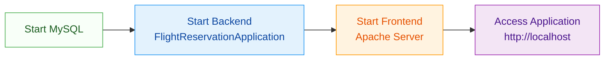
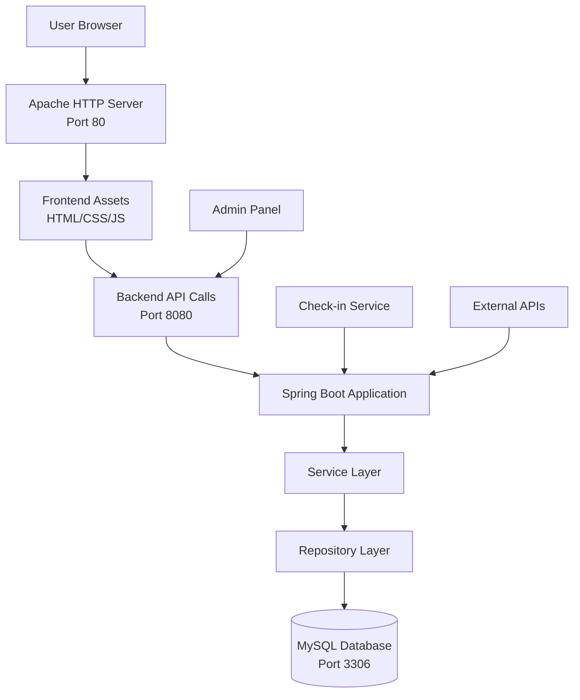

# Flight-reservation

- **Project Overview**: Introduction to the flight reservation system and its architecture.
- **Prerequisites**: Required tools and software before starting.
- **Repository Setup**: How to clone and organize the project files.
- **Database Configuration**: MySQL setup and initialization steps.
- **Backend Setup**: Java and Maven configuration for the server.
- **Frontend Setup**: Node.js and Vite configuration for the user interface.
- **Application Execution**: How to start and access the system.
- **Troubleshooting**: Common issues and their solutions.

-------

# 🛫 Complete Flight Reservation Application Setup Guide for Beginners

## 📋 1. Project Overview

This **Flight Reservation System** is a full-stack web application that allows users to search for flights, make reservations, and manage bookings. The project follows a **client-server architecture** with:

- **Backend**: Java-based Spring Boot application providing REST APIs
- **Frontend**: Modern JavaScript application built with Vite and served via Apache
- **Database**: MySQL relational database for data persistence
- **Architecture**: Three-tier design (Presentation, Application, Data layers)

The system consists of two main modules:
1. **FlightReservationApplication**: Core reservation and booking functionality
2. **FlightCheckInApplication**: Check-in services for passengers

## 🧰 2. Prerequisites

Before you begin, ensure you have the following tools installed on your system:

### Required Software & Tools

| Tool | Version | Purpose | Verification Command |
|------|---------|---------|----------------------|
| **Java JDK** | 17+ | Backend runtime environment | `java -version` |
| **Maven** | 3.6+ | Java build tool | `mvn -version` |
| **Node.js** | 16+ | JavaScript runtime | `node -version` |
| **npm** | 8+ | Package manager for JavaScript | `npm -version` |
| **MySQL Server** | 8.0+ | Database management system | `mysql --version` |
| **Git** | Latest | Version control system | `git --version` |
| **Apache HTTP Server** | 2.4+ | Web server for frontend | `apache2 -v` |

### System Requirements
- **Operating System**: Linux (Ubuntu 20.04+ recommended) or Windows WSL
- **RAM**: Minimum 4GB (8GB recommended)
- **Disk Space**: 5GB available space
- **Network**: Internet connection for dependency downloads

## 🗂️ 3. Repository Setup and Understanding

### 3.1 Choosing the Right Repository

current repo 

### 3.2 Cloning the Repository

Open your terminal and execute these commands:

```bash
# Clone the recommended repository
git clone https://github.com/Vickybarai/Flight-reservation.git

# Navigate to the project directory
cd Flight-reservation

# Verify the structure
ls -la
```

### 3.3 Understanding Project Structure

The project follows a standard Maven structure with separate frontend and backend modules:

```
Flight-reservation/
├── 📁 FlightReservationApplication/    # Backend - Java/Spring Boot
│   ├── 📁 src/main/java/              # Java source code
│   ├── 📁 src/main/resources/         # Configuration files
│   └── 📄 pom.xml                     # Maven dependencies
│
├── 📁 FlightCheckInApplication/       # Check-in service module
│   └── ... (similar structure)
│
├── 📁 frontend/                       # Frontend - JavaScript/Vite
│   ├── 📁 src/                        # Source files
│   ├── 📁 public/                     # Static assets
│   ├── 📄 package.json                # Node dependencies
│   └── 📄 vite.config.js              # Vite configuration
│
├── 📄 sql.txt                         # Database schema initialization
├── 📄 BuildCommands.txt               # Reference build commands
└── 📄 Readme.md                       # Project documentation
```

<details>
<summary>🔍 Detailed File Descriptions</summary>

- **FlightReservationApplication/**: Contains the main backend code including controllers, services, repositories, and models for flight reservation functionality.
- **FlightCheckInApplication/**: Handles passenger check-in operations, seat selection, and boarding pass generation.
- **frontend/**: Contains the user interface built with modern JavaScript frameworks, likely React or Vue based on the project structure.
- **sql.txt**: Database initialization script that creates tables for flights, passengers, reservations, and other entities.
- **BuildCommands.txt**: Reference file containing common commands for building and running the project.
</details>

## 🗄️ 4. Database Configuration

### 4.1 MySQL Installation and Security

```bash
# Install MySQL Server (Ubuntu/Debian)
sudo apt update
sudo apt install mysql-server -y

# Secure MySQL installation
sudo mysql_secure_installation
```

### 4.2 Database and User Creation

Login to MySQL as root and create the necessary database and user:

```bash
# Login to MySQL
sudo mysql -u root -p

# Execute the following SQL commands
```

```sql
-- Create database
CREATE DATABASE flightdb;

-- Create user with password (replace 'YourSecurePassword123!' with your own)
CREATE USER 'linux'@'localhost' IDENTIFIED BY 'YourSecurePassword123!';

-- Grant privileges
GRANT ALL PRIVILEGES ON flightdb.* TO 'linux'@'localhost';
FLUSH PRIVILEGES;

-- Exit MySQL
EXIT;
```

### 4.3 Database Schema Initialization

```bash
# Import the database schema
mysql -u linux -p flightdb < sql.txt

# Verify tables were created
mysql -u linux -p flightdb -e "SHOW TABLES;"
```

<details>
<summary>⚠️ Important Database Notes</summary>

1. **Default Credentials**: The repositories show default credentials (`linux`/`Redhat`) in environment variables. **Change these immediately** in production environments 【turn0fetch0】【turn0fetch1】.

2. **Character Set**: Ensure your database uses UTF-8 character set:
   ```sql
   ALTER DATABASE flightdb CHARACTER SET utf8mb4 COLLATE utf8mb4_unicode_ci;
   ```

3. **Backup Strategy**: Regular backups are crucial. Consider setting up automated backups:
   ```bash
   # Create backup script
   mysqldump -u linux -p flightdb > backup_$(date +%Y%m%d).sql
   ```
</details>

## ☕ 5. Backend Setup

### 5.1 Environment Configuration

Set the required environment variables for the backend application:

```bash
# Set database connection details
export DATASOURCE_URL="jdbc:mysql://localhost:3306/flightdb"
export DATASOURCE_USER="linux"
export DATASOURCE_PASSWORD="YourSecurePassword123!"

# Set frontend URL for CORS configuration
export FRONTEND_URL="http://localhost"

# Optional: Set server port (default is 8080)
export SERVER_PORT=8080
```

### 5.2 Backend Build and Run

```bash
# Navigate to backend directory
cd FlightReservationApplication

# Build the project using Maven
mvn clean package

# Run the application
java -jar target/flight*.jar
```

<details>
<summary>🔧 Advanced Backend Configuration</summary>

If you encounter issues with the default configuration, you can modify the application properties:

```bash
# Navigate to resources directory
cd src/main/resources

# Edit application.properties (create if not exists)
nano application.properties
```

Add/modify these properties:
```properties
# Server Configuration
server.port=8080

# Database Configuration
spring.datasource.url=jdbc:mysql://localhost:3306/flightdb
spring.datasource.username=linux
spring.datasource.password=YourSecurePassword123!
spring.datasource.driver-class-name=com.mysql.cj.jdbc.Driver

# JPA/Hibernate Configuration
spring.jpa.hibernate.ddl-auto=update
spring.jpa.show-sql=true
spring.jpa.properties.hibernate.dialect=org.hibernate.dialect.MySQL8Dialect

# Logging Configuration
logging.level.org.springframework=INFO
logging.level.com.yourpackage=DEBUG
```
</details>

## 🎨 6. Frontend Setup

### 6.1 Frontend Dependencies Installation

```bash
# Navigate to frontend directory
cd frontend

# Install Node.js dependencies
npm install
```

### 6.2 Frontend Configuration

Set the API endpoint URL for the frontend:

```bash
# Set API URL (points to backend)
export VITE_API_URL=http://localhost:8080

# Optional: Set base URL for assets
export VITE_BASE_URL=/
```

### 6.3 Frontend Build and Deployment

```bash
# Build the frontend for production
npm run build

# Deploy to Apache web server
sudo cp -r dist/* /var/www/html/

# Set proper permissions
sudo chown -R www-data:www-data /var/www/html/
sudo chmod -R 755 /var/www/html/
```

<details>
<summary>⚙️ Alternative: Development Server</summary>

For development purposes, you can run the frontend in development mode:

```bash
# Start development server with hot reload
npm run dev

# The frontend will be available at http://localhost:5173
# This is useful for development but not for production
```

**Note**: If using the development server, you'll need to configure CORS in your backend to allow requests from `http://localhost:5173`.
</details>

## 🚀 7. Application Execution

### 7.1 Starting the Complete System

Follow this sequence to start all components:



### 7.2 Verification Steps

1. **Check Backend Health**:
   ```bash
   # Test backend API
   curl http://localhost:8080/actuator/health
   
   # Or visit in browser: http://localhost:8080
   ```

2. **Check Frontend**:
   - Open browser and navigate to `http://localhost`
   - You should see the flight reservation interface

3. **Test Database Connection**:
   ```bash
   # Verify database connectivity
   mysql -u linux -p flightdb -e "SELECT 1;"
   ```

## 🐛 8. Troubleshooting Common Issues

<details>
<summary>❓ Frequently Asked Questions & Solutions</summary>

### **Issue 1: "Access denied for user 'linux'@'localhost'"**
**Solution**: Verify MySQL user creation and privileges:
```sql
-- Check user exists
SELECT user, host FROM mysql.user WHERE user = 'linux';

-- Check privileges
SHOW GRANTS FOR 'linux'@'localhost';

-- Recreate user if needed
DROP USER 'linux'@'localhost';
CREATE USER 'linux'@'localhost' IDENTIFIED BY 'YourSecurePassword123!';
GRANT ALL PRIVILEGES ON flightdb.* TO 'linux'@'localhost';
FLUSH PRIVILEGES;
```

### **Issue 2: "Port 8080 already in use"**
**Solution**: Find and kill the process using port 8080:
```bash
# Find process using port 8080
sudo lsof -i :8080

# Kill the process (replace PID with actual process ID)
sudo kill -9 <PID>

# Or change backend port in application.properties
server.port=8081
```

### **Issue 3: "npm ERR! code ELIFECYCLE" during frontend build**
**Solution**: Clear npm cache and reinstall:
```bash
# Clear npm cache
npm cache clean --force

# Delete node_modules and package-lock.json
rm -rf node_modules package-lock.json

# Reinstall dependencies
npm install

# Try building again
npm run build
```

### **Issue 4: "Frontend not loading CSS/JS files"**
**Solution**: Check Apache configuration and file permissions:
```bash
# Check Apache error logs
sudo tail -f /var/log/apache2/error.log

# Ensure files have correct permissions
sudo chmod -R 755 /var/www/html/

# Restart Apache
sudo systemctl restart apache2
```

### **Issue 5: "Database connection failed"**
**Solution**: Verify MySQL is running and credentials are correct:
```bash
# Check MySQL status
sudo systemctl status mysql

# Test connection manually
mysql -u linux -p -h localhost flightdb

# Check JDBC URL in backend configuration
echo $DATASOURCE_URL
```
</details>

## 📊 9. Project Architecture Overview



## 🎯 10. Next Steps After Setup

Once you have the system running, here are some recommended next steps:

1. **Explore the Application**:
   - Browse through different features (search flights, make reservations)
   - Understand the user flow and functionality

2. **Examine the Code**:
   - Study the backend API endpoints in `FlightReservationApplication`
   - Review the frontend components in the `frontend/src` directory

3. **Make Modifications**:
   - Try changing the UI colors or text in the frontend
   - Add a new field to a database table and update the corresponding backend/frontend code

4. **Learn from the Structure**:
   - Understand how the backend is organized (controllers, services, repositories)
   - See how the frontend communicates with the backend via API calls

## 📚 11. Additional Resources

<details>
<summary>📖 Learning Resources & Documentation</summary>

### **Backend Technologies**:
- [Spring Boot Documentation](https://spring.io/projects/spring-boot)
- [Java JDBC Documentation](https://docs.oracle.com/javase/tutorial/jdbc/)
- [Maven User Guide](https://maven.apache.org/guides/index.html)

### **Frontend Technologies**:
- [Vite Documentation](https://vitejs.dev/)
- [JavaScript MDN Documentation](https://developer.mozilla.org/en-US/docs/Web/JavaScript)
- [CSS Tricks](https://css-tricks.com/)

### **Database**:
- [MySQL Reference Manual](https://dev.mysql.com/doc/refman/8.0/en/)
- [SQL Tutorial](https://www.w3schools.com/sql/)

### **Project Specific**:
- Original repository README files 【turn0fetch0】【turn0fetch1】【turn0fetch2】
- Build commands reference in `BuildCommands.txt`
</details>

## ✅ 12. Setup Verification Checklist

Use this checklist to ensure you've completed all setup steps:

- [ ] Repository cloned successfully
- [ ] Java 17+ installed and verified
- [ ] Maven installed and verified
- [ ] Node.js and npm installed and verified
- [ ] MySQL server installed and secured
- [ ] Database `flightdb` created
- [ ] Database user `linux` created with proper privileges
- [ ] Database schema imported from `sql.txt`
- [ ] Environment variables set for backend
- [ ] Backend builds successfully with `mvn clean package`
- [ ] Backend runs without errors on port 8080
- [ ] Frontend dependencies installed with `npm install`
- [ ] Frontend builds successfully with `npm run build`
- [ ] Frontend deployed to Apache web server
- [ ] Application accessible at `http://localhost`
- [ ] All features tested and working

## 🆘 13. Getting Help

If you encounter issues not covered in this guide:

1. **Check the original repository issues**: Look for similar problems in the GitHub repository issues section
2. **Search for error messages**: Copy-paste error messages into Google or Stack Overflow
3. **Verify file permissions**: Ensure all files have correct read/write permissions
4. **Check logs**: Examine backend logs (`target/` directory) and Apache error logs (`/var/log/apache2/`)
5. **Ask for help**: Provide detailed error messages and steps you've already tried

---
